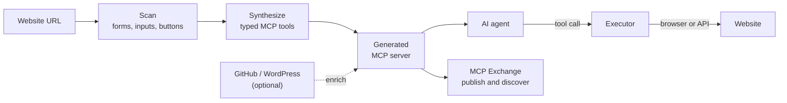

<p align="center">
  
</p>

<h1 align="center">MCPEX</h1>

<p align="center">
  <strong>Give any website an MCP server, so AI agents can use it.</strong>
</p>

<p align="center">
  <a href="https://app.bh2026.tekitup.net">Live app</a> ·
  <a href="https://hotel.bh2026.tekitup.net">Demo hotel</a> ·
  <a href="assets/mcp-creator-launch-video-without-music.mp4">Launch video</a> ·
  <a href="documentation/TUTORIAL_CONNECT_AGENTS.md">Connect an agent</a> ·
  <a href="documentation/mcp-exchange.md">MCP Exchange</a>
</p>

<p align="center">
  
  
  
</p>

---

## The problem

Soon, people will ask an agent to "book me a hotel room in Basel for the 14th". Agents cannot reliably click through arbitrary websites. MCP (Model Context Protocol) solves this by letting a site expose typed tools, but most websites have no MCP server and never will.

## The solution

MCPEX is the missing bridge. Give it a URL, and it analyses the site and generates an MCP server that any compatible agent can call.



## Demo

1. Open the [app](https://app.bh2026.tekitup.net) and enter `https://hotel.bh2026.tekitup.net`, a booking site with no MCP and no public API.
2. MCPEX generates a server with tools such as `check_availability` and `reserve_room`.
3. Connect an agent to the server's endpoint.
4. Ask the agent to book a room. It searches, prepares the booking, and waits for a human to approve it.

## Features

- **MCP generation:** turns a website into a server with typed tools, using a real browser.
- **Code enrichment:** uses a GitHub repository or WordPress site to find internal API routes and call them directly.
- **Agent connections:** supports MCP over SSE, a stdio bridge and a REST API.
- **Server management:** enables or disables each server and tool from the dashboard.
- **MCP Exchange:** publishes generated MCPs so others can find and connect to them.

## Safe by design

- **Human approval:** bookings, payments and other irreversible actions need explicit confirmation before they run.
- **Authorised sites only:** the backend only automates allowlisted sites by default (`ALLOWED_SITE_ORIGINS`).
- **Audit log:** tool calls are recorded in `audit_logs/tool-calls.jsonl`.
- **Fictitious data only:** the demo uses no real payments and no real personal data.

## Quick start

You need Node.js 24 and npm. Run each service in its own terminal.

```bash
# Backend: http://localhost:3000 (API docs at /docs)
cd code/backend
npm ci
npx playwright install chromium
npm run start:dev
```

```bash
# Frontend: http://localhost:5173
cd code/frontend
npm ci
MCPEX_BACKEND_URL=http://localhost:3000 npm run dev
```

Then generate an MCP for the built-in test hotel:

```bash
curl -X POST localhost:3000/api/v1/generate \
  -H 'content-type: application/json' \
  -d '{"url":"http://localhost:3000/mock-hotel"}'
```

## Connect an agent

| Transport | Best for | Endpoint or command |
| --- | --- | --- |
| SSE | Cursor, web agents, MCP SDKs | `GET /api/v1/servers/<id>/mcp/sse` |
| Stdio | Claude Desktop, local CLI agents | `node code/backend/bin/mcp-runner.mjs <id>` |
| REST | Custom scripts | `POST /api/v1/servers/<id>/call` |

Use `latest` as the `<id>` to target the most recent server. See the [full tutorial](documentation/TUTORIAL_CONNECT_AGENTS.md) for each agent's configuration, and the [setup guide](documentation/local-setup.md) for environment variables.

## Repository layout

| Path | Contents |
| --- | --- |
| [`code/backend`](code/backend) | NestJS API: MCP creator, executor, agent transports and Exchange |
| [`code/frontend`](code/frontend) | React and Vite dashboard |
| [`code/mcp_creator`](code/mcp_creator) | Standalone Python (FastAPI) MCP creator |
| [`code/infra`](code/infra) | NixOS and OpenTofu deployment, updated automatically by comin |
| [`documentation`](documentation) | Setup guide, agent tutorial and Exchange docs |
| [`assets`](assets) | Logo and other media |

The demo hotel lives in its own repository: [hotel-website-demo](https://github.com/agrand2004/hotel-website-demo).

## Team

Built in two days at BaselHack 2026 by:

[vmbr068](https://github.com/vmbr068) ·
[GabinP-Epitech2027](https://github.com/GabinP-Epitech2027) ·
[agrand2004](https://github.com/agrand2004) ·
[sramstein](https://github.com/sramstein) ·
[Neptnium](https://github.com/Neptnium) ·
[Corent1P](https://github.com/Corent1P) ·
[Loic-ally](https://github.com/Loic-ally) ·
[ChapkaBoy](https://github.com/ChapkaBoy)

## License

[MIT](license.txt)
